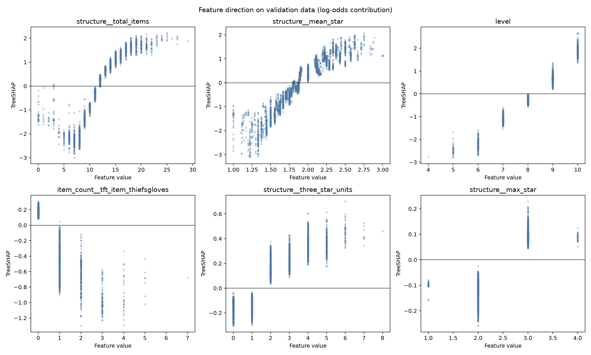

# Chapter 4: Results and Discussion

## 4.1 Overview of the evaluation and discussion

The frozen dataset contained 5,000 completed matches and 40,000 participant-level end-state observations. Matches were assigned chronologically to 3,500 training, 750 validation, and 750 final-test matches, with all eight participants from a match retained in the same partition. Because each valid match contains exactly four top-four and four bottom-four participants, the binary outcome was balanced by construction rather than by resampling. The final test set remained frozen during feature and model selection.

The analysis addressed six related questions. It examined which final-board features were associated with top-four placement (RQ1), whether selected associations persisted after adjustment for observed covariates (RQ2), how much predictive information was added by increasingly detailed feature families (RQ3), which features contributed most strongly to the locked model's predictions (RQ4), how accurately exact placement could be estimated (RQ5), and whether the main findings remained stable under the prespecified sensitivity checks (RQ6). F1 was the primary top-four selection metric. Exact-placement performance was assessed using accuracy, macro F1, mean absolute error (MAE), and accuracy within one and two placement positions.

Results and interpretation are presented together because the same numerical pattern can answer different questions depending on the analysis. A descriptive uplift measures an observed difference in outcome rates. An adjusted odds ratio estimates a conditional association under a specified model. A feature-family increment measures additional predictive information, while an ablation or SHAP value describes model reliance. None of these quantities identifies the causal effect of choosing a unit, item, or trait.

## 4.2 Composition features associated with top-four placement

The frozen cohort had a top-four rate of exactly 50% because every accepted match contributed four top-four and four bottom-four observations. Feature-level comparisons were restricted by prespecified support thresholds so that sparse boards did not dominate the rankings. Table 4.1 presents selected findings that illustrate the main descriptive and adjusted patterns. The complete ranked results remain in the versioned analysis artifacts.

**Table 4.1. Selected final-board associations with top-four placement**

| Feature | Type | Support | Top-four rate | Uplift from cohort | Raw odds ratio | Adjusted odds ratio (95% CI) |
| --- | --- | ---: | ---: | ---: | ---: | --- |
| Shen | Unit | 8,199 | 65.8% | +15.8 pp | 2.27 | 1.84 (1.66 to 2.04) |
| Aurora | Unit | 2,387 | 38.8% | -11.2 pp | 0.62 | Not estimated |
| Blitzcrank | Unit | 9,300 | 61.0% | +11.0 pp | 1.79 | 1.94 (1.73 to 2.17) |
| Morgana | Unit | 10,303 | 60.8% | +10.8 pp | 1.80 | 1.79 (1.65 to 1.94) |
| Force Of Nature | Item | 331 | 77.0% | +27.0 pp | 3.39 | Not estimated |
| Madreds Bloodrazor | Item | 14,790 | 57.8% | +7.8 pp | 1.65 | 1.28 (1.19 to 1.37) |
| Frozen Heart | Item | 12,714 | 56.7% | +6.7 pp | 1.49 | 1.07 (0.99 to 1.15) |
| Space Groove tier 4 with 7 units | Trait signature | 1,222 | 70.8% | +20.8 pp | 2.49 | Not estimated |

Among units meeting the 200-board support threshold, Shen had the largest positive uplift and Aurora the largest negative uplift. Force Of Nature had the largest supported item uplift, although its support of 331 boards was much lower than that of the common units and items. The leading trait result was the observed Space Groove tier-4, seven-unit signature. Trait labels refer to the tier and unit-count values recorded in the Riot payload; canonical breakpoints were not inferred.

Unit-star results also showed that outcome rates differed across upgrade levels for several well-supported units. Exploratory unit-item, trait-unit, and trait-trait interactions were retained only when they met the 150-observation threshold. The strongest retained interaction was the joint Hptank tier-1, two-unit and Shen Unique tier-1, one-unit signature. These interaction rankings are exploratory because the search considered many correlated combinations and because an end-state interaction may reflect the route by which a successful board was assembled rather than an independently reproducible strategic effect.

The descriptive rankings answer RQ1 by showing that unit, item, trait, star-level, and structural configurations were not distributed independently of final placement. Their substantive meaning is limited by the end-state design. Access to expensive units, completed items, higher player levels, and advanced trait configurations generally requires economy and survival. A positive end-state association can therefore represent both the value of the observed board and the earlier advantage that made the board attainable. Aurora's negative association likewise does not establish that selecting Aurora reduced a player's chance of finishing in the top four; it may reflect the contexts in which the unit appeared.

## 4.3 Raw and adjusted associations

The training-partition adjusted logistic analysis tested whether a limited set of common descriptive findings retained their direction after controlling for approved board-state and participant covariates. Match-cluster-robust confidence intervals accounted for the eight dependent participant observations contributed by each match. Adjustment did not cover every ranked feature, and a missing adjusted estimate in Table 4.1 means that no defensible direct mapping was available within the prespecified regression terms.

Shen, Blitzcrank, and Morgana retained positive adjusted associations. Shen's raw odds ratio of 2.27 decreased to 1.84, whereas the Blitzcrank and Morgana estimates changed little. Madreds Bloodrazor attenuated from a raw odds ratio of 1.65 to an adjusted odds ratio of 1.28. Frozen Heart attenuated more strongly, from 1.49 to 1.07, and its adjusted confidence interval included one. These differences show why raw outcome-rate rankings and conditional estimates should not be treated as interchangeable.

This evidence answers RQ2 cautiously. Some associations persisted after adjustment, while others weakened materially. Persistence supports the narrower claim that an association was not removed by the included covariates. Attenuation indicates sensitivity to the adjustment set, but it does not quantify how much confounding was explained. The model could not control for shop offers, economy trajectories, positioning, opponent boards, carousel access, combat randomness, or the sequence of decisions that produced the final board. The adjusted results therefore remain observational associations rather than causal estimates.

## 4.4 Incremental feature-family performance

The five feature families were cumulative: F1 contained basic final-board state; F2 added unit and star-level information; F3 added traits; F4 added items; and F5 added composition-structure summaries. Table 4.2 reports the frozen logistic-regression comparison used to examine the incremental information associated with these feature families.

**Table 4.2. Validation performance of the cumulative feature families**

| Feature family | Accuracy | Precision | Recall | F1 | ROC-AUC | PR-AUC | Change in F1 from preceding family |
| --- | ---: | ---: | ---: | ---: | ---: | ---: | ---: |
| F1 | 0.6847 | 0.7237 | 0.5973 | 0.6545 | 0.7377 | 0.7151 | — |
| F2 | 0.8127 | 0.8156 | 0.8080 | 0.8118 | 0.8950 | 0.8974 | +0.1573 |
| F3 | 0.8150 | 0.8178 | 0.8107 | 0.8142 | 0.8972 | 0.8996 | +0.0024 |
| F4 | 0.8495 | 0.8498 | 0.8490 | 0.8494 | 0.9276 | 0.9293 | +0.0352 |
| F5 | 0.8513 | 0.8525 | 0.8497 | 0.8511 | 0.9290 | 0.9307 | +0.0017 |

The largest increase occurred when unit and star-level information was introduced in F2, which raised F1 by 0.1573. Adding trait information in F3 produced little further improvement, whereas adding item information in F4 increased F1 by 0.0352. F5 yielded the highest validation F1, but its 0.0017 improvement over F4 was small. The feature-family results therefore answer RQ3 by showing that the identity and upgrade state of the units contributed the largest incremental gain over basic board state, with item information supplying the next substantial increase.

The small F3 increment does not mean that traits were irrelevant. Unit and trait encodings overlap because fielded units determine trait activation, so much of the trait signal may already have been available to F2. The same caution applies to the small F5 increment. Structural summaries were added after detailed unit, trait, and item features and could therefore be partly redundant even if they formed a strong predictive representation on their own. This cumulative comparison establishes the best combined feature family under the frozen protocol; it does not rank isolated substantive units.

## 4.5 Model selection and comparative performance

Six prespecified classifiers were compared on the F5 feature family. Table 4.3 separates the five-fold cross-validation evidence from the validation result used by the frozen selection rule.

**Table 4.3. Frozen top-four model comparison and selection**

| Model | Mean CV F1 | CV SD | Validation F1 | Selected |
| --- | ---: | ---: | ---: | :---: |
| LightGBM | 0.8500 | 0.0058 | 0.8525 | No |
| Logistic regression | 0.8494 | 0.0033 | 0.8511 | No |
| XGBoost | 0.8494 | 0.0044 | **0.8543** | **Yes** |
| CatBoost | 0.8476 | 0.0052 | 0.8522 | No |
| Random forest | 0.8350 | 0.0028 | 0.8350 | No |
| Dummy classifier | 0.0000 | 0.0000 | 0.0000 | No |

LightGBM had the highest mean cross-validation F1, exceeding XGBoost by 0.00061. A paired comparison across the five folds produced a 95% confidence interval from -0.00124 to 0.00245 and a paired *t*-test *p*-value of 0.414. The available evidence therefore does not establish intrinsic superiority for either boosted-tree model. Logistic regression also remained a competitive parsimonious benchmark.

XGBoost was selected because the analysis contract specified validation F1, rather than the cross-validation mean, as the decisive selection criterion. It achieved the highest validation F1 (0.8543), compared with 0.8525 for LightGBM. The selected model and the default decision threshold of 0.5 were then locked before the single audited final-test evaluation. XGBoost should therefore be described as the winner under the prespecified rule, not as a statistically superior algorithm.

The closeness of the leading models is itself informative. Three different modelling approaches produced validation F1 scores within 0.0032 of one another. This suggests that most of the usable signal was present in the feature representation and was not dependent on one specialised algorithm. XGBoost offered the best frozen validation result, but logistic regression remained a competitive and more easily inspected benchmark. For an application that valued simpler deployment or coefficient-level interpretation over the small observed validation difference, the simpler model could still be reasonable. That alternative was not adopted here because changing the decision rule after examining the results would violate the analysis contract.

## 4.6 Strongest substantive predictive unit

To identify the strongest substantive unit, the selected XGBoost specification was re-evaluated using fold-local grouped cross-validation. Two complementary analyses were conducted. Unit-only models measured how much signal each unit contained on its own, while leave-one-unit-out ablations measured the deterioration after removing one unit from the full F5 specification.

**Table 4.4. Unit-only and leave-one-unit-out grouped cross-validation results**

| Substantive unit | Unit-only mean F1 | Mean F1 without unit | F1 deterioration when removed | Paired 95% CI |
| --- | ---: | ---: | ---: | ---: |
| Basic board state | 0.6487 | 0.8431 | 0.0054 | 0.0022 to 0.0086 |
| Units | 0.7799 | 0.8471 | 0.0014 | -0.00001 to 0.00273 |
| Traits | 0.7067 | 0.8473 | 0.0011 | -0.0003 to 0.0026 |
| Items | 0.7433 | 0.8419 | 0.0065 | 0.0051 to 0.0079 |
| Composition structure | **0.8091** | **0.8238** | **0.0246** | **0.0184 to 0.0309** |

The full F5 model achieved mean grouped-CV F1 of 0.8484 (SD 0.0049). Composition structure was the strongest unit-only specification, with F1 of 0.8091. It was also the most consequential ablation: removing structure reduced mean F1 to 0.8238, a deterioration of 0.02465. The paired-fold 95% confidence interval was 0.01836 to 0.03093, and performance deteriorated in all five folds. Removing items produced the next-largest deterioration (0.00649), considerably smaller than the effect of removing structure.

TreeSHAP provided an independent model-based view of predictive importance. As shown in Figure 4.1, composition structure had the largest aggregate mean absolute contribution (2.281), followed by units (1.237) and items (1.225). Structure achieved the largest aggregate contribution despite comprising only nine encoded features. The most influential individual features were total item count, mean star level, player level, Thief's Gloves count, and the number of three-star units. Figure 4.2 displays the direction and magnitude of the selected features' contributions on the validation data.

**Figure 4.1.** Aggregate absolute TreeSHAP contribution by substantive unit for the frozen development XGBoost model.

**Figure 4.2.** Feature values and their TreeSHAP log-odds contributions on the validation data. Positive values increase the fitted model's top-four score; negative values decrease it, conditional on the other model inputs.

The agreement between the unit-only, ablation, and TreeSHAP analyses answers RQ4 by identifying composition structure as the strongest substantive predictive unit in this dataset. The analyses answer different questions, however: ablation measures the loss in out-of-fold performance when information is removed, whereas SHAP allocates contributions within the fitted model. Correlation can distribute importance among substitutes; 137 encoded feature pairs had an absolute validation correlation of at least 0.90. The ablation evidence is therefore the primary basis for ranking units, with SHAP used as corroborating interpretation.

This result also explains why the cumulative F4-to-F5 improvement was small even though structure was the strongest unit in isolation. F4 already contained units, traits, and items from which several structural characteristics could be inferred. When explicit structural summaries were added, they supplied little new information beyond those detailed variables. When the same summaries were evaluated alone or removed as a group, however, they formed a compact representation of board maturity and resource accumulation. The apparent contrast is therefore a consequence of redundancy, not a contradiction between analyses.

## 4.7 Generalisation, calibration, and robustness

Table 4.5 compares the locked XGBoost model on validation and final-test data. The test metrics closely reproduced the validation results.

**Table 4.5. Validation and final-test performance of the locked XGBoost classifier**

| Metric | Validation | Final test | Test 95% match-bootstrap CI |
| --- | ---: | ---: | ---: |
| Accuracy | 0.8547 | 0.8533 | 0.8453 to 0.8617 |
| Precision | 0.8566 | 0.8517 | — |
| Recall | 0.8520 | 0.8557 | — |
| F1 | 0.8543 | 0.8537 | 0.8453 to 0.8620 |
| ROC-AUC | 0.9311 | 0.9305 | 0.9251 to 0.9357 |
| PR-AUC | 0.9330 | 0.9326 | — |
| Brier score | 0.1046 | 0.1055 | 0.1010 to 0.1099 |
| Log loss | 0.3344 | 0.3355 | 0.3238 to 0.3477 |

Final-test F1 was only 0.00060 below validation F1, while accuracy decreased by 0.00133 and ROC-AUC by 0.00067. The final confusion matrix contained 2,553 true negatives, 447 false positives, 433 false negatives, and 2,567 true positives. These small gaps provide no evidence of a material validation-to-test performance collapse.

Additional sensitivity analyses supported stability. Across three deterministic grouped-CV seeds, mean F1 ranged from 0.8479 to 0.8484. Ordinary match-grouped folds contained 1,009 to 1,052 participant identities in both the fitting and held-out portions of their respective folds, although participant identifiers were prohibited predictors. A stricter player-connected-component sensitivity analysis removed participant overlap entirely and retained mean F1 of 0.8477 (SD 0.0067). This similarity indicates that the principal result was not driven by repeated participants across the ordinary cross-validation folds, although the component analysis was post hoc and had uneven fold sizes.

Probability metrics were also similar across validation and test. At the frozen 0.5 threshold, test Brier score was 0.1055, log loss was 0.3355, and 10-bin expected calibration error was 0.0092. No alternative application threshold had been documented before evaluation, so none was constructed or optimised after observing the final test.

The composition findings were also examined under predeclared minimum-support thresholds. The main feature analyses used thresholds of 100, 200, 300, and 500 observations, while the retained interaction analyses used 100, 150, 250, and 500 where reconstructable. Rank-order correlations and top-list overlap were reported across these thresholds, and Benjamini-Hochberg q-values were used for multiplicity control. Across 182 supported comparisons evaluated separately in the training and validation partitions, 159 (87.4%) retained the same direction. These checks answer RQ6 by showing that most supported development findings were directionally stable and that the primary predictive result was insensitive to seed and participant-overlap checks. They do not amount to external replication because all observations came from the same frozen patch cohort.

## 4.8 Exact-placement performance and interpretation

Exact placement was a substantially more difficult outcome than binary top-four status. Table 4.6 presents grouped-CV results for the locked random forest and the most-frequent dummy baseline.

**Table 4.6. Grouped cross-validation performance for exact placement**

| Model | Accuracy | Macro F1 | Weighted F1 | MAE | Median absolute error | Within +/-1 | Within +/-2 |
| --- | ---: | ---: | ---: | ---: | ---: | ---: | ---: |
| Dummy | 0.1250 | 0.0278 | 0.0278 | 3.5000 | 3.5000 | 0.2500 | 0.3750 |
| Random forest | **0.3328** | **0.3233** | **0.3233** | **1.1183** | **1.0000** | **0.7030** | **0.8924** |

The random forest was materially better than the dummy baseline on every metric. Although it predicted the exact placement in approximately one-third of grouped-CV observations, 70.3% of predictions were within one position and 89.2% were within two. Its mean error was 1.1183 positions (fold SD 0.0097), compared with 3.5000 positions for the dummy model.

On the final test, exact-placement accuracy was 0.3493 (95% match-bootstrap CI 0.3383 to 0.3607), macro F1 was 0.3402, and MAE was 1.0648 positions (95% CI 1.0393 to 1.0912). Final-test accuracy within one position was 0.7235 (95% CI 0.7122 to 0.7347), and accuracy within two positions was 0.8992 (95% CI 0.8908 to 0.9073). The final-test confusion matrix in Figure 4.3 shows that errors were concentrated around the diagonal, while substantial confusion remained among neighbouring middle placements.

**Figure 4.3.** Final-test confusion matrix for the locked exact-placement random forest. Rows represent true placement and columns represent predicted placement.

The placement findings answer RQ5 by showing that final-board features carried substantial information about placement order but did not support reliable exact classification. The eight-class task requires the model to distinguish neighbouring outcomes that may be separated by small combat or tiebreak differences. Top-four classification collapses those distinctions into a balanced binary boundary and is therefore less demanding. The concentration of errors near the confusion-matrix diagonal explains why exact accuracy remained moderate while the within-one and within-two measures were much higher.

## 4.9 Integrated discussion of the research questions

### 4.9.1 Meaning of the predictive performance

The final-test F1 of 0.8537 and ROC-AUC of 0.9305 establish that final-board state contains strong information about whether a participant finished in the top four. This result is credible within the study because the model was selected on validation data, locked before test access, and evaluated on a later chronological partition. The near-zero validation-to-test gaps reduce concern that the headline performance resulted from a favourable validation sample.

The source of that information must nevertheless be interpreted in relation to when the board was observed. A final board is both a strategic configuration and an outcome of the match process. Players who survive longer have more opportunities to level, acquire items, upgrade units, and complete trait structures. The classifier can therefore recognise the accumulated state of a successful game without identifying which earlier decision produced the success. The reported accuracy belongs to an end-of-match classification problem and cannot be transferred to early-game forecasting.

The error distribution reinforces this interpretation. Fourth- and fifth-place observations lie immediately on opposite sides of the binary decision boundary and had relatively high error rates in the frozen diagnostic analysis. Exact-placement errors were concentrated among neighbouring classes. Both patterns are consistent with a model that captures broad board strength while remaining unable to reconstruct every combat outcome, tiebreak, and stochastic event that separates close placements.

### 4.9.2 Descriptive association and model importance

The feature analyses should be read as complementary rather than as a single ranking. Raw uplift is easiest to interpret because it states the observed difference from the cohort top-four rate. Its weakness is that it does not condition on other board characteristics. The adjusted model addresses selected measured covariates, but only for a limited set of common terms and under a linear log-odds specification. TreeSHAP captures conditional and nonlinear behaviour in XGBoost but explains the model's score rather than the match outcome. Ablation measures the performance lost when a feature group is withheld, although correlated substitutes can reduce that loss.

This distinction explains why a feature can have a large raw uplift without leading the SHAP ranking, and why composition structure can dominate the ablation analysis despite adding only 0.0017 F1 after F4. Force Of Nature, for example, had a 27.0 percentage-point uplift but appeared on only 331 boards and may mark exceptional late-game resource accumulation. Total item count and mean star level were more broadly available summaries that the model could use across many boards. Agreement across raw, adjusted, ablation, and SHAP evidence strengthens a finding; disagreement identifies sensitivity to support, covariate adjustment, nonlinearity, or correlation rather than proving that one method is wrong.

## 4.10 Limitations

### 4.10.1 Observational end-state design

The largest limitation is that all predictors describe the final board. The temporal order of shops, rerolls, economy decisions, item choices, positioning changes, and combat outcomes is absent. Survivorship affects many leading predictors because later survivors can reach higher levels, field expensive units, complete more items, and activate advanced traits. Endogeneity operates in both directions: a strong board may improve survival, while prior survival and accumulated advantage make a strong board possible. The analysis cannot separate these mechanisms.

Selected-covariate adjustment reduces imbalance only for recorded variables and specified terms. It does not identify a counterfactual outcome for a player who would have chosen a different unit, item, or trait. Accordingly, positive associations and SHAP contributions should not be converted into strategic recommendations or statements that a feature causes top-four placement.

### 4.10.2 Measurement and feature availability

The Riot response did not provide the complete trajectory of player decisions or the random offers available at each stage. Item-acquisition routes, shop contents, opponent positioning, and combat targeting were unobserved. Augments were planned for analysis where available but were absent from the frozen participant schema; they were not inferred or merged from an external source. Their omitted contribution may be important because augments can affect economy, unit choice, trait construction, and combat strength.

Rank was measured when the participant snapshot was retrieved, not when the match was played. It may include progress made after the observed match or may misclassify participants who changed rank during the collection window. Rank was therefore retained only as contextual metadata and excluded from the primary predictive matrix. Apparent rank-level differences may reflect true heterogeneity, retrieval timing, regional composition, or small subgroup sizes.

### 4.10.3 Dependence, multiplicity, and model comparison

Every match remained intact across partitions and folds, which controlled the strongest known dependence among its eight participants. Some participant identities appeared in both fitting and held-out folds under ordinary match grouping. The player-connected-component sensitivity removed that overlap and produced similar performance, but it was conducted after the primary analysis and had uneven fold sizes because connected components were indivisible.

The descriptive analysis evaluated many units, items, traits, star levels, and interactions. Minimum-support rules and Benjamini-Hochberg correction reduced the risk of promoting sparse or chance findings, but they cannot eliminate selection effects in ranked lists. The 87.4% directional replication rate across training and validation is reassuring while also showing that 23 of 182 supported comparisons did not retain direction. Individual feature findings therefore require more caution than the aggregate model-performance result.

Model comparison was based on five grouped folds and one validation partition. Differences among XGBoost, LightGBM, and logistic regression were small relative to the fold-level variability. Selection on the highest validation F1 can confer a modest winner's advantage even when the test set remains untouched. The final-test agreement supports the selected model's performance, but it does not establish that XGBoost would dominate across new patches or alternative samples.

### 4.10.4 Structural balance and calibration

The binary outcome was balanced by the complete-match sampling design, not by oversampling. This makes accuracy and F1 straightforward to interpret for complete eight-player matches. It also means that predictive values and calibration are tied to a population containing all participants from complete matches. They may change in a filtered population, at an earlier game stage, or in an application where the prevalence of eventual top-four finishes differs from 50%.

The reported 10-bin expected calibration error was small, but a binned estimate can conceal local deviations and depends on the binning rule. No application-specific decision cost or alternative probability threshold was prespecified. The threshold of 0.5 was therefore retained, and the analysis cannot claim that it is optimal for a practical decision-support setting.

### 4.10.5 External validity and interpretability

The study covers ranked standard matches from Set 17 on Patch 17.8 within the enabled regions, rank strata, collection window, and eligibility rules. TFT balance changes can alter unit costs, item effects, trait breakpoints, player behaviour, and the metagame. No later patch, different set, independent collection, or prospective sample was evaluated. Regional and rank-stratified analyses are internal subgroup descriptions rather than external validation.

SHAP values and ablation losses are specific to the fitted model, feature definitions, and frozen cohort. Correlated predictors can divide or transfer attribution, and aggregate SHAP totals depend partly on how features are grouped. The agreement between the ablation and SHAP results makes the composition-structure conclusion more credible, but neither method yields a unique explanation of player success.

## 4.11 Chapter conclusion

Final-board composition supported strong retrospective top-four classification within the Patch 17.8 cohort, while exact-placement classification remained moderate. Composition structure was the strongest substantive predictive unit, and units, upgrades, and items supplied most of the incremental information. These results were stable across the principal internal checks but do not establish causal effects, live-game utility, or generalisation beyond the sampled patch and population.
