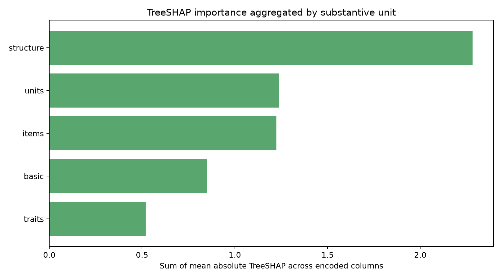
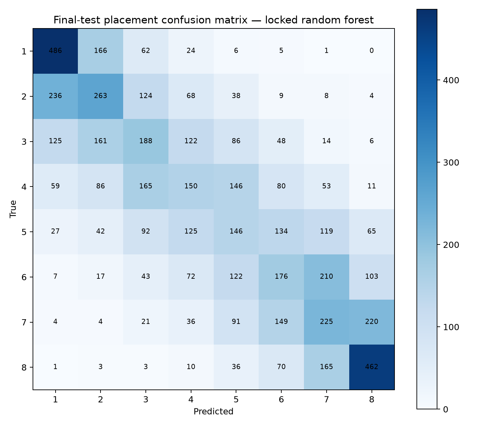

# Chapter 4: Results

## 4.1 Overview of the evaluation

The frozen dataset contained 5,000 completed matches and 40,000 participant-level end-state observations. Matches were assigned chronologically to 3,500 training, 750 validation, and 750 final-test matches, with all eight participants from a match retained in the same partition. Because each valid match contains exactly four top-four and four bottom-four participants, the binary outcome was balanced by construction rather than by resampling. The final test set remained frozen during feature and model selection.

The primary analysis addressed whether final-board composition features could classify a participant as finishing in the top four. A secondary analysis evaluated the more difficult task of predicting the exact final placement from first to eighth. F1 was the primary top-four selection metric. Exact-placement performance was assessed using accuracy, macro F1, mean absolute error (MAE), and accuracy within one and two placement positions.

## 4.2 Feature-family performance

The five feature families were cumulative: F1 contained basic final-board state; F2 added unit and star-level information; F3 added traits; F4 added items; and F5 added composition-structure summaries. Table 4.1 reports the frozen logistic-regression comparison used to examine the incremental information associated with these feature families.

**Table 4.1. Validation performance of the cumulative feature families**

| Feature family | Accuracy | Precision | Recall | F1 | ROC-AUC | PR-AUC | Change in F1 from preceding family |
| --- | ---: | ---: | ---: | ---: | ---: | ---: | ---: |
| F1 | 0.6847 | 0.7237 | 0.5973 | 0.6545 | 0.7377 | 0.7151 | — |
| F2 | 0.8127 | 0.8156 | 0.8080 | 0.8118 | 0.8950 | 0.8974 | +0.1573 |
| F3 | 0.8150 | 0.8178 | 0.8107 | 0.8142 | 0.8972 | 0.8996 | +0.0024 |
| F4 | 0.8495 | 0.8498 | 0.8490 | 0.8494 | 0.9276 | 0.9293 | +0.0352 |
| F5 | 0.8513 | 0.8525 | 0.8497 | 0.8511 | 0.9290 | 0.9307 | +0.0017 |

The largest increase occurred when unit and star-level information was introduced in F2, which raised F1 by 0.1573. Adding trait information in F3 produced little further improvement, whereas adding item information in F4 increased F1 by 0.0352. F5 yielded the highest validation F1, but its 0.0017 improvement over F4 was small. The feature-family results therefore support F5 as the strongest combined specification while indicating that F4 already captured almost all of its predictive performance. This cumulative comparison does not, by itself, identify the most important substantive unit because each later family retains the preceding information.

## 4.3 Frozen model-selection rule

Six prespecified classifiers were compared on the F5 feature family. Table 4.2 separates the five-fold cross-validation evidence from the validation result used by the frozen selection rule.

**Table 4.2. Frozen top-four model comparison and selection**

| Model | Mean CV F1 | CV SD | Validation F1 | Selected |
| --- | ---: | ---: | ---: | :---: |
| LightGBM | 0.8500 | 0.0058 | 0.8525 | No |
| Logistic regression | 0.8494 | 0.0033 | 0.8511 | No |
| XGBoost | 0.8494 | 0.0044 | **0.8543** | **Yes** |
| CatBoost | 0.8476 | 0.0052 | 0.8522 | No |
| Random forest | 0.8350 | 0.0028 | 0.8350 | No |
| Dummy classifier | 0.0000 | 0.0000 | 0.0000 | No |

LightGBM had the highest mean cross-validation F1, exceeding XGBoost by 0.00061. A paired comparison across the five folds produced a 95% confidence interval from -0.00124 to 0.00245 and a paired *t*-test *p*-value of 0.414. The available evidence therefore does not establish intrinsic superiority for either boosted-tree model. Logistic regression also remained a competitive parsimonious benchmark.

XGBoost was selected because the analysis contract specified validation F1—not the cross-validation mean—as the decisive selection criterion. It achieved the highest validation F1 (0.8543), compared with 0.8525 for LightGBM. The selected model and the default decision threshold of 0.5 were then locked before the single audited final-test evaluation. Consequently, XGBoost should be described as the winner under the prespecified frozen rule, not as a statistically superior algorithm.

## 4.4 Strongest substantive predictive unit

To identify the strongest substantive unit, the selected XGBoost specification was re-evaluated using fold-local grouped cross-validation. Two complementary analyses were conducted. Unit-only models measured how much signal each unit contained on its own, while leave-one-unit-out ablations measured the deterioration after removing one unit from the full F5 specification.

**Table 4.3. Unit-only and leave-one-unit-out grouped cross-validation results**

| Substantive unit | Unit-only mean F1 | Mean F1 without unit | F1 deterioration when removed | Paired 95% CI |
| --- | ---: | ---: | ---: | ---: |
| Basic board state | 0.6487 | 0.8431 | 0.0054 | 0.0022 to 0.0086 |
| Units | 0.7799 | 0.8471 | 0.0014 | -0.00001 to 0.00273 |
| Traits | 0.7067 | 0.8473 | 0.0011 | -0.0003 to 0.0026 |
| Items | 0.7433 | 0.8419 | 0.0065 | 0.0051 to 0.0079 |
| Composition structure | **0.8091** | **0.8238** | **0.0246** | **0.0184 to 0.0309** |

The full F5 model achieved mean grouped-CV F1 of 0.8484 (SD 0.0049). Composition structure was the strongest unit-only specification, with F1 of 0.8091. It was also the most consequential ablation: removing structure reduced mean F1 to 0.8238, a deterioration of 0.02465. The paired-fold 95% confidence interval was 0.01836 to 0.03093, and performance deteriorated in all five folds. Removing items produced the next-largest deterioration (0.00649), considerably smaller than the effect of removing structure.

TreeSHAP provided an independent model-based view of predictive importance. As shown in Figure 4.1, composition structure had the largest aggregate mean absolute contribution (2.281), followed by units (1.237) and items (1.225). Structure achieved the largest aggregate contribution despite comprising only nine encoded features. The most influential individual features were total item count, mean star level, player level, Thief's Gloves count, and the number of three-star units. Figure 4.2 displays the direction and magnitude of the selected features' contributions on the validation data.

**Figure 4.1.** Aggregate absolute TreeSHAP contribution by substantive unit for the frozen development XGBoost model.

**Figure 4.2.** Feature values and their TreeSHAP log-odds contributions on the validation data. Positive values increase the fitted model's top-four score; negative values decrease it, conditional on the other model inputs.

The agreement between the unit-only, ablation, and TreeSHAP analyses supports the conclusion that composition structure was the strongest substantive predictive unit in this dataset. The analyses answer different questions, however: ablation measures the loss in out-of-fold performance when information is removed, whereas SHAP allocates contributions within the fitted model. Correlation can distribute importance among substitutes; 137 encoded feature pairs had an absolute validation correlation of at least 0.90. The ablation evidence is therefore the primary basis for ranking units, with SHAP used as corroborating interpretation.

## 4.5 Generalisation and stability

Table 4.4 compares the locked XGBoost model on validation and final-test data. The test metrics closely reproduced the validation results.

**Table 4.4. Validation and final-test performance of the locked XGBoost classifier**

| Metric | Validation | Final test | Test 95% match-bootstrap CI |
| --- | ---: | ---: | ---: |
| Accuracy | 0.8547 | 0.8533 | 0.8453 to 0.8617 |
| Precision | 0.8566 | 0.8517 | — |
| Recall | 0.8520 | 0.8557 | — |
| F1 | 0.8543 | 0.8537 | 0.8453 to 0.8620 |
| ROC-AUC | 0.9311 | 0.9305 | 0.9251 to 0.9357 |
| PR-AUC | 0.9330 | 0.9326 | — |
| Brier score | 0.1046 | 0.1055 | 0.1010 to 0.1099 |
| Log loss | 0.3344 | 0.3355 | 0.3238 to 0.3477 |

Final-test F1 was only 0.00060 below validation F1, while accuracy decreased by 0.00133 and ROC-AUC by 0.00067. The final confusion matrix contained 2,553 true negatives, 447 false positives, 433 false negatives, and 2,567 true positives. These small gaps provide no evidence of a material validation-to-test performance collapse.

Additional sensitivity analyses supported stability. Across three deterministic grouped-CV seeds, mean F1 ranged from 0.8479 to 0.8484. Ordinary match-grouped folds contained some participants in both fitting and held-out folds, although participant identifiers were prohibited predictors. A stricter player-connected-component sensitivity analysis removed participant overlap entirely and retained mean F1 of 0.8477 (SD 0.0067). This similarity indicates that the principal result was not driven by repeated participants across the ordinary cross-validation folds.

Probability metrics were also similar across validation and test. At the frozen 0.5 threshold, test Brier score was 0.1055, log loss was 0.3355, and 10-bin expected calibration error was 0.0092. No alternative application threshold had been documented before evaluation, so none was constructed or optimized after observing the final test.

## 4.6 Exact-placement performance

Exact placement was a substantially more difficult outcome than binary top-four status. Table 4.5 presents grouped-CV results for the locked random forest and the most-frequent dummy baseline.

**Table 4.5. Grouped cross-validation performance for exact placement**

| Model | Accuracy | Macro F1 | Weighted F1 | MAE | Median absolute error | Within +/-1 | Within +/-2 |
| --- | ---: | ---: | ---: | ---: | ---: | ---: | ---: |
| Dummy | 0.1250 | 0.0278 | 0.0278 | 3.5000 | 3.5000 | 0.2500 | 0.3750 |
| Random forest | **0.3328** | **0.3233** | **0.3233** | **1.1183** | **1.0000** | **0.7030** | **0.8924** |

The random forest was materially better than the dummy baseline on every metric. Although it predicted the exact placement in approximately one-third of grouped-CV observations, 70.3% of predictions were within one position and 89.2% were within two. Its mean error was 1.1183 positions (fold SD 0.0097), compared with 3.5000 positions for the dummy model.

On the final test, exact-placement accuracy was 0.3493 (95% match-bootstrap CI 0.3383 to 0.3607), macro F1 was 0.3402, and MAE was 1.0648 positions (95% CI 1.0393 to 1.0912). Final-test accuracy within one position was 0.7235 (95% CI 0.7122 to 0.7347), and accuracy within two positions was 0.8992 (95% CI 0.8908 to 0.9073). The final-test confusion matrix in Figure 4.3 shows that errors were concentrated around the diagonal, while substantial confusion remained among neighbouring middle placements.

**Figure 4.3.** Final-test confusion matrix for the locked exact-placement random forest. Rows represent true placement and columns represent predicted placement.

The placement findings should therefore be characterized as moderate exact prediction but useful ordinal proximity. They do not support a claim that the precise finishing position can be predicted reliably in most cases.

## 4.7 Predictive importance and causal interpretation

The study was designed to evaluate prediction from observational end-state data, not to estimate causal effects. The ablation result shows that composition-structure information improved out-of-fold classification when it was available to the model. TreeSHAP shows how the fitted XGBoost model allocated its predictions among correlated inputs. Neither analysis demonstrates that intervening to change a structural feature would cause a participant to finish in the top four.

Several features, including item totals, star levels, and player level, are themselves products of earlier game processes such as economy, survival, and accumulated advantage. They may act as summaries of an already favourable game state. Unmeasured strategy, player skill, decision timing, opponent strength, and game-specific events could influence both the final-board features and placement. Accordingly, the defensible interpretation is that composition structure was the strongest *predictive* unit in the observed final-board data. Causal language such as “composition structure causes top-four placement” is not supported.

## 4.8 Limitations

### 4.8.1 Observational and end-state design

The analysis used observational final-board records. Residual confounding cannot be eliminated, and temporal ordering among strategic decisions is not represented by the end-state matrix. The model is an end-of-match classifier rather than an early-game forecasting or prescriptive decision system. Its performance should not be interpreted as evidence that the same accuracy would be available at an earlier stage of play.

### 4.8.2 Structural class balance

Top-four status is balanced because every complete eight-participant match contains four positive and four negative outcomes; exact placement similarly contributes one observation to each position. This is a property of the full-match sampling design, not synthetic oversampling. It makes the reported accuracy and F1 metrics readily interpretable for complete matches. However, precision, predictive values, and calibration may change if the model is applied to a filtered participant population, incomplete match records, or another setting with a different outcome prevalence.

### 4.8.3 Dependence and model comparison

Grouping prevented a match from crossing partitions or folds, but some participants appeared in multiple chronological partitions and in ordinary CV fitting and held-out folds. The zero-overlap player-component sensitivity result was reassuring, but it was post hoc and does not replace external replication. Model comparisons were based on only five paired folds; consequently, small differences among XGBoost, LightGBM, and logistic regression should not be overinterpreted. Selection on the highest validation F1 may also confer a small winner's advantage, although the untouched test set provided a separate assessment.

### 4.8.4 External validity

The evidence applies to the sampled ranked standard matches from TFT Set 17 on Patch 17.8, under the study's regions, rank coverage, collection window, and eligibility rules. Changes in patches, units, items, traits, player behaviour, matchmaking, or regional metagames may alter both feature meanings and model performance. No cross-patch, cross-set, future-season, or independently collected external validation was conducted. Generalisation beyond the frozen study population therefore remains unestablished.

### 4.8.5 Interpretability under correlated features

SHAP magnitudes are model- and dataset-specific. Correlated and redundant features can divide or transfer attribution, and aggregate SHAP totals are affected by both feature contributions and the number of encoded columns within a unit. The agreement with leave-one-unit-out ablation strengthens the ranking of composition structure, but neither method provides a unique causal decomposition.

## 4.9 Results summary

The locked XGBoost classifier achieved final-test F1 of 0.8537 and ROC-AUC of 0.9305, closely reproducing its validation performance and remaining stable under repeated grouped CV and a stricter participant-disjoint sensitivity analysis. Under the frozen validation-based rule, XGBoost was correctly selected, although it was not demonstrably superior to LightGBM or the competitive logistic-regression benchmark.

Composition structure was the strongest substantive predictive unit. Its removal reduced grouped-CV F1 by 0.02465, with a paired-fold 95% confidence interval of 0.01836 to 0.03093 and deterioration in every fold. Unit-only performance and TreeSHAP independently supported this ranking. Exact-placement prediction was materially better than chance but remained moderate: final-test exact accuracy was 0.3493, while 0.7235 of predictions were within one position and 0.8992 were within two. Taken together, the findings support strong and stable top-four classification from final-board composition features, but not causal claims or unrestricted generalisation beyond the frozen observational setting.
